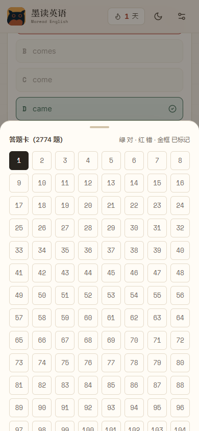

<p align="center">
  
</p>

<p align="center">
  <a href="https://cheshiping.github.io/English-practicing/"><b>▶ 在线使用：cheshiping.github.io/English-practicing</b></a>
  <br/>
  纯静态 · 无后端 · 打开即用 · 学习数据保存在浏览器本地
</p>

---

## 界面速览

| 精读首页 | 阅读器 · 点词查义 |
| --- | --- |
|  |  |
| **文章库 · 120 篇阅读** | **单选练习 · 答题卡底部弹层** |
|  |  |

<p align="center">
  
</p>

## 它是什么

把每一篇英语阅读，变成可反复精读、可查、可练、可记的材料。整站是一个纯静态站点：文章与题目内置在页面数据里，点词查义用的是离线词典，所有学习数据（进度、生词、错题、批注）保存在浏览器 localStorage —— 没有后端、没有账号，换设备时用设置页的 JSON 备份迁移。

## 功能

### 精读阅读

- **点词查义**：内置 2.6 万词离线英汉词典（ECDICT），支持词形还原、音标、考试标签与浏览器发音
- **划句翻译**：选中句子查看参考译文、重点词汇与从句/逻辑提示，也可生成全文翻译
- **批注**：选中文本四色高亮、写笔记，批注面板可回跳原文
- **计时**：正计时 / 倒计时、快捷键、可拖动悬浮卡，离开页面不丢失

### 单选练习（2774 题）

- 按语法框架（六大词性 / 两个态 / 三大从句 / 五大句型 / 四个重点 / 其他）分大类与细分考点，选好考点**直接练完全部题目**
- **答一题判一题**：点选项立即判定对错，即时显示正确答案、考点标签与中文解析，错题实时入错题本
- **答题卡从底部弹出**：点「答题卡」按钮唤起底部面板，题号按绿对 / 红错 / 金框标记着色，点题号直接跳题
- **进度自动保存**：中途退出或刷新页面都不丢，重新进入后在设置页点「继续上次练习」即可回到**上次答过的最后一道题**，已答统计与标记一并恢复
- **错题本**：错题重做、单题移除、清空、最近练习记录

### 语法速查

按 2·3·4·5·6 框架（两个态 / 三大从句 / 四个重点 / 五大句型 / 六大词性）原样收录完整语法笔记，支持关键词搜索、分区跳转与移动端吸顶导航；答题时可新标签打开，不打断作答。

### 词汇与学习数据

生词本支持收录、搜索、筛选、发音、掌握度与间隔复习、导出 CSV；学习数据页汇总阅读时长、完成篇目、答题正确率、连续天数与 14 天柱状图。

### 排版与导入

纸感 / 纯白 / 夜间三主题，字号、行高、字体、版心宽度、两端对齐皆可调；站内粘贴 Markdown 或拖入 `.md` / `.txt` 即可导入自己的文章与题目。

## 快速开始

```bash
npm install
npm run dev      # 开发模式，打开 http://localhost:3000
npm run build    # 内容生成 + 静态导出，产物在 out/
```

预览静态产物：

```bash
python -m http.server 3000 --directory out
```

## 添加文章

文章源文件放在 `article/*.md`，支持以下格式：

```markdown
Passage 1

English passage...

1. Question ______.
A. Option A
B. Option B
C. Option C
D. Option D
答案：A
解析：在原文第 2 段...
```

- 用 `Passage 1` 分隔多篇；题目以 `1.` 开头，选项以 `A.` 开头；答案与解析可选
- 在 `Passage N` 下一行写 `<!-- id: xxx -->` 可固定文章 id，重排分类后仍沿用原进度与答案
- 修改后运行 `npm run content` 重新生成数据
- 阅读题答案写在 `src/data/answers/*.json`（按文章 id + 题号）；单选练习的答案、考点分类与解析在 `src/data/answers/danxuan.json`
- 不改代码也能用：进入站内「导入文章」页面，粘贴内容或拖入文件即可

## 部署到 GitHub Pages

推送到 `main` 分支后，`.github/workflows/deploy.yml` 会自动构建并部署：`actions/configure-pages` 自动探测仓库路径并注入 `NEXT_PUBLIC_BASE_PATH`，无需手动配置。

**当前部署地址：[https://cheshiping.github.io/English-practicing/](https://cheshiping.github.io/English-practicing/)**

> 站点使用 hash 路由（`#/read/kepu-01`），GitHub Pages 下无需任何 404 重写规则。

## 目录结构

```
app/                  Next.js 页面、全局样式与设计系统
article/              文章 Markdown 源文件（唯一内容源）
scripts/              文章解析、练习数据、词典生成脚本
src/components/       页面与阅读器组件
src/lib/              解析、词典、翻译、存储、路由
src/data/             生成的文章数据、答案、译文、分类元信息
public/dict/          离线英汉词典（ECDICT 按字母拆分块）
assets/readme/        README 视觉素材
.github/workflows/    GitHub Pages 自动部署
```

## 说明

- 词典数据来自 [ECDICT](https://github.com/skywind3000/ECDICT)（MIT License）；重新生成词典后请运行 `npm run dict:split` 拆分词典块
- 文章内容仅用于学习，请勿用于商业转载
- 所有数据保存在浏览器本地：清缓存或换设备前，先在「设置」页导出 JSON 备份
